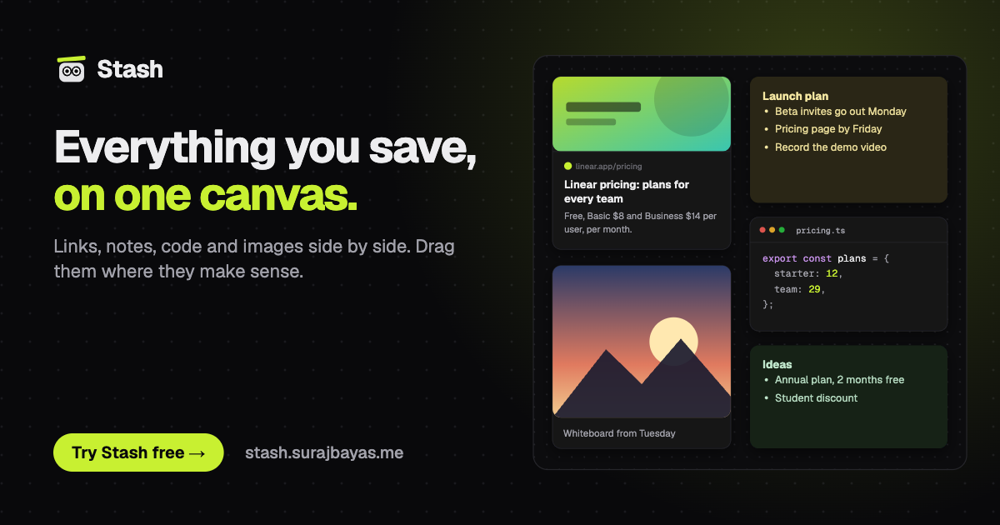
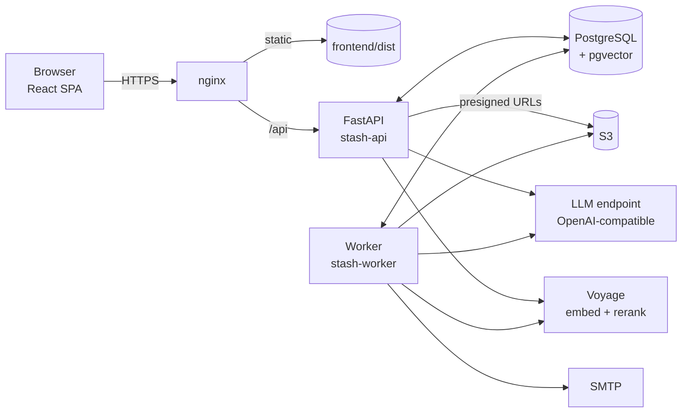

<div align="center">


# Stash

**Everything you save, on one canvas.**

Drop in links, notes, code and images. Ask a question and Stash answers from your own cards, pointing at each one.
Set a reminder and it reaches your inbox right on time.

[](https://github.com/SurajsinghBayas/stash/actions/workflows/ci-cd.yml)
[](https://stash.surajbayas.me)


[**Try it**](https://stash.surajbayas.me) · [Features](#features) · [Architecture](#architecture) ·
[Run locally](#getting-started) · [Deploy](deploy/README.md)



</div>

---

## Why Stash

Bookmarks, notes apps, screenshots and chat threads each hold a piece of what you save, and none of them help you
find it again. Stash puts everything on one infinite canvas you arrange yourself, then makes it searchable in plain
language: answers come only from your own cards and every claim links back to the card it came from.

## Features

**Canvas**
- Infinite canvas with link, note, text, code and image cards; drag, resize, colour and arrange freely
- Rich link previews, Markdown notes, syntax-highlighted code, image uploads with captions
- Templates to start from, version history, and a 30-day trash with undo and restore
- Read-only public share links that can be revoked at any time

**Ask Stash**
- Chat over a canvas; answers cite the exact cards they use, which light up on the canvas
- Hybrid retrieval (full text + vectors, reciprocal rank fusion, reranking) with a verification pass on cited answers
- `⌘K` quick find across every canvas

**Reminders and capture**
- Reminders on any card, delivered by email on time; daily or weekly digests of what you saved
- Save from anywhere: the system share sheet (installable PWA) or by forwarding an email

**Your data, your control**
- Sign in with Google, X or email and password
- Export everything as JSON; delete your account and all data in one step
- Every card, upload and AI answer passes a content-safety gate before it is shown, stored or sent

## Architecture



- **API** (`backend/app`): FastAPI with async SQLAlchemy. Cookie-based JWT sessions with silent refresh, CSRF origin
  checks, per-user rate limits and a monthly AI token budget.
- **Worker** (`app/worker.py`): a Postgres-backed job queue (`FOR UPDATE SKIP LOCKED`, no extra infrastructure) that
  indexes cards, reads links, sends reminders and digests, and purges deleted data after 30 days.
- **Chat** (`services/agents`): a LangGraph turn of *plan → retrieve → rank → answer → verify*, streamed to the
  browser over Server-Sent Events. Citations are restricted to cards that were actually retrieved.
- **Safety** (`services/safety`): a local word and domain list plus a policy moderator model for text and a vision
  model for images. Production refuses to start without it.
- **Frontend** (`frontend/src`): React 19, React Flow canvas, TanStack Query with optimistic updates, Tailwind CSS 4
  and Radix primitives. Lazy-loaded routes and per-page SEO metadata.

More detail: [`AI.md`](AI.md) (models and pipelines), [`FEATURES.md`](FEATURES.md) (feature list),
[`PLAN.md`](PLAN.md) (design and milestones).

## Tech stack

| Layer | Technology |
| --- | --- |
| Frontend | React 19, TypeScript, Vite, Tailwind CSS 4, React Flow, TanStack Query, Radix UI |
| Backend | Python 3.11+, FastAPI, SQLAlchemy 2 (asyncpg), Alembic, Pydantic, LangGraph |
| Data | PostgreSQL with full-text search and pgvector; Amazon S3 for images |
| AI | OpenAI-compatible chat models (Amazon Bedrock), Voyage embeddings and rerank |
| Infrastructure | AWS EC2 + RDS (Mumbai), nginx, systemd, GitHub Actions |

## Repository layout

```
backend/            FastAPI app, worker, Alembic migrations, tests, retrieval evals
  app/routes/       HTTP endpoints (auth, canvases, items, chat, reminders, uploads, sharing, …)
  app/services/     domain logic: agents, search, safety, mail, reminders, digests, uploads
frontend/           React single-page app
  src/canvas/       the canvas, cards and their sync logic
  src/pages/        dashboard, settings, reminders, public pages
deploy/             server setup, nginx and systemd units, deploy scripts
marketing/          generated ad kit: images, videos, soundtrack and voiceover
.github/workflows/  CI (lint, tests, build) and continuous deployment
```

## Getting started

**Prerequisites:** Python 3.11+ with [uv](https://docs.astral.sh/uv/), Node.js 22, and PostgreSQL 16+
([pgvector](https://github.com/pgvector/pgvector) is optional and enables semantic search).

```bash
git clone https://github.com/SurajsinghBayas/stash.git && cd stash

# Backend: API on http://localhost:4000
cd backend
cp .env.example .env          # set DATABASE_URL and JWT_SECRET; everything else is optional
uv sync
uv run alembic upgrade head
uv run uvicorn app.main:app --port 4000 --reload

# Worker (second terminal): indexing, reminders, digests
cd backend && uv run python -m app.worker

# Frontend (third terminal): http://localhost:5173, proxies /api to the backend
cd frontend
npm ci
npm run dev
```

To develop without AI keys, set `SAFETY_REQUIRED=false` in `.env`: the local safety word list still applies, the
canvas, sharing and reminders work, and chat reports that the assistant is off. Without SMTP, emails are written to
the API log. Without S3, uploads are stored in `backend/.uploads`.

## Configuration

All settings are environment variables, documented in [`backend/.env.example`](backend/.env.example).

| Variable | Purpose |
| --- | --- |
| `DATABASE_URL` | PostgreSQL connection string (required) |
| `JWT_SECRET` | Session signing key, 32+ random characters (required) |
| `APP_URL` | Public origin, used for cookies, email links and CSRF checks |
| `GOOGLE_*`, `X_*` | OAuth sign-in (optional) |
| `SMTP_*`, `MAIL_FROM` | Outgoing mail for verification, reminders and digests |
| `OPENAI_API_KEY`, `OPENAI_BASE_URL` | OpenAI-compatible endpoint for chat, reading and moderation |
| `VOYAGER_API_KEY` | Voyage embeddings and rerank |
| `S3_BUCKET`, `AWS_REGION` | Image storage |
| `SAFETY_REQUIRED` | Content safety gate; always on in production |

## Testing

```bash
cd backend
uv run ruff check .
uv run pytest -q                                   # needs a Postgres test database, see tests/conftest.py
uv run python -m pytest tests/test_eval.py -s      # retrieval quality on the golden set in evals/

cd frontend
npm run build                                      # type-check and production build
```

CI runs the same checks on every push and pull request against PostgreSQL 17.

## Deployment

Every push to `main` that passes CI is deployed automatically: GitHub Actions connects to the server with a key that
can only run [`deploy/remote-deploy.sh`](deploy/remote-deploy.sh), which checks out that exact commit, installs
dependencies, runs migrations, builds the frontend, restarts the services and waits for `/health/ready`.
First-time server setup and AWS resources are covered step by step in [`deploy/README.md`](deploy/README.md).

## Security

- Passwords hashed with Argon2; sessions in `HttpOnly`, `SameSite` cookies with short-lived access tokens
- Uploaded images are private in S3, served through short-lived presigned URLs, resized and stripped of EXIF
- Content flagged as adult or abusive is never shown, indexed, emailed or used in answers
- Secrets live only in the server's environment file; nothing sensitive reaches the frontend bundle or the logs

Found a vulnerability? Please report it privately to the maintainer rather than opening a public issue.

## Contributing

Contributions are welcome. See [`CONTRIBUTING.md`](CONTRIBUTING.md) for setup, checks and the pull request process.

---

<div align="center">
Built by <a href="https://github.com/SurajsinghBayas">SurajsinghBayas</a> ·
<a href="https://stash.surajbayas.me">stash.surajbayas.me</a>
</div>
